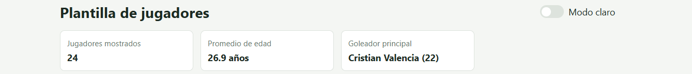
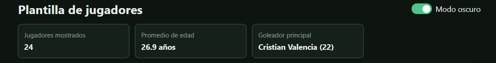
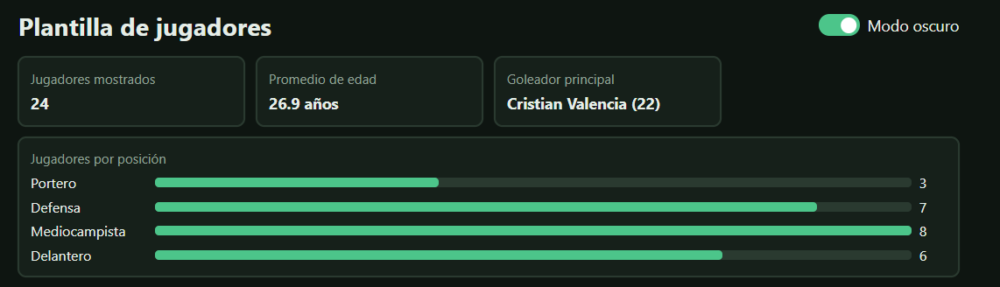
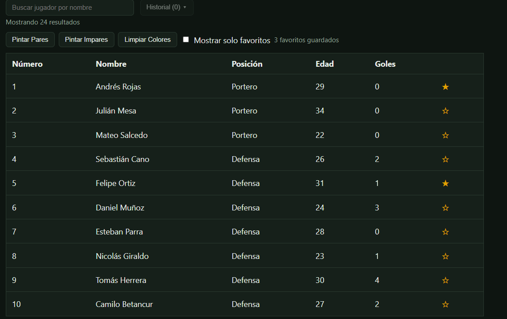
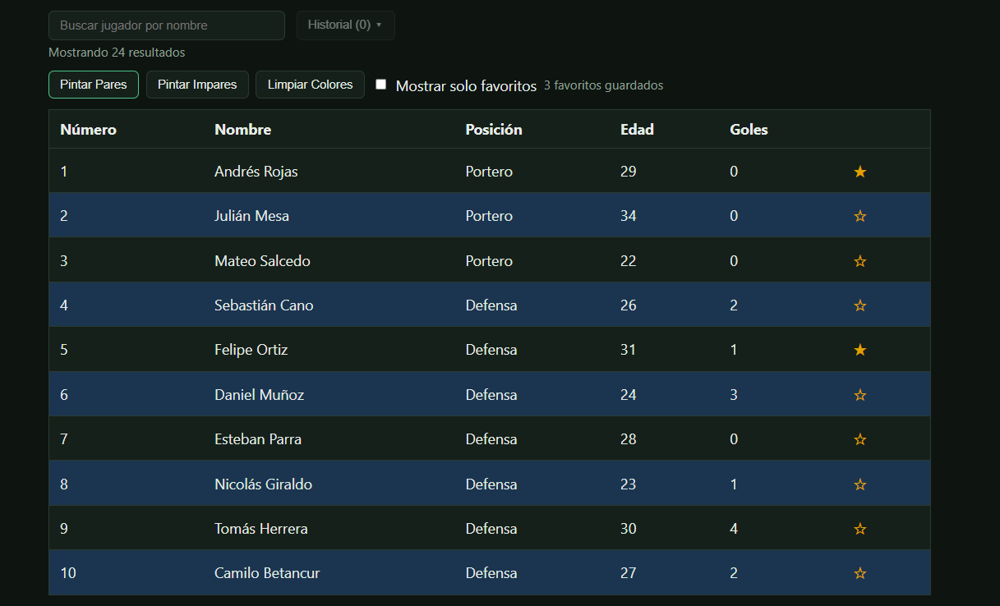
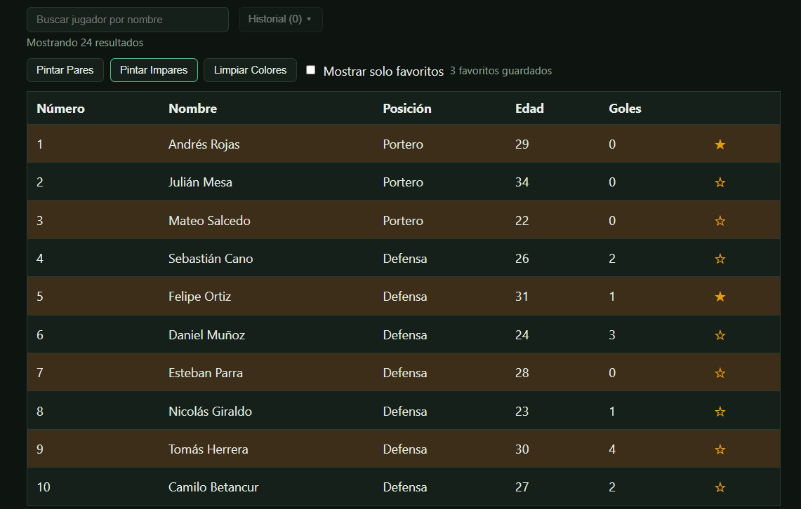
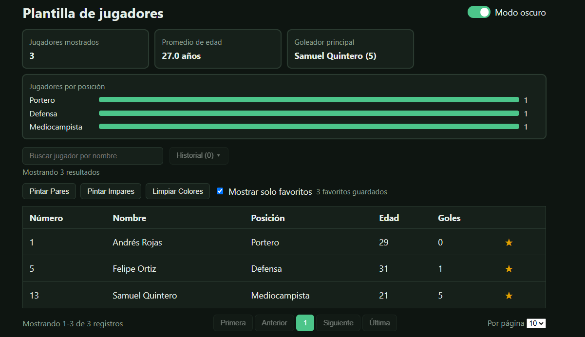

# Tabla de jugadores — React Hooks

Tabla interactiva de jugadores con búsqueda con debounce, paginación, ordenamiento, modo oscuro, favoritos, historial de búsquedas y estadísticas en tiempo real.

**IA utilizada:** Claude (Anthropic) — Ayuda en gran medida a la creacion del codigo.

## Instalación

```bash
npm install
npm start        # desarrollo
npm run build    # producción (carpeta dist)
```

## Hooks utilizados

- `useState`: búsqueda, página actual, tamaño de página, ordenamiento, modal, favoritos, tema, coloreo de filas.
- `useEffect`: debounce con cleanup, persistencia en `localStorage` (tema, favoritos, historial) y reinicio de la paginación al filtrar.
- `useMemo`: filtrado, ordenamiento y estadísticas.

## Estructura

```
src/
├── App.jsx
├── App.css
├── data/players.js
└── components/
    ├── SearchBar.jsx   SearchHistory.jsx
    ├── PlayerTable.jsx PlayerRow.jsx
    ├── Pagination.jsx  StatsPanel.jsx
    └── Modal.jsx       ThemeToggle.jsx
```

## Integrantes

- Miguel Ángel Téllez Berrio

## Deploy

[_Link de Netlify stately-platypus-95984d.netlify.app_]([https://stately-platypus-95984d.netlify.app](https://stately-platypus-95984d.netlify.app))

## Capturas

### Primer Vista


### Segunda Vista


### Paginación


### Pares


### Modal de detalles


### Impares


### Favoritos e historial

